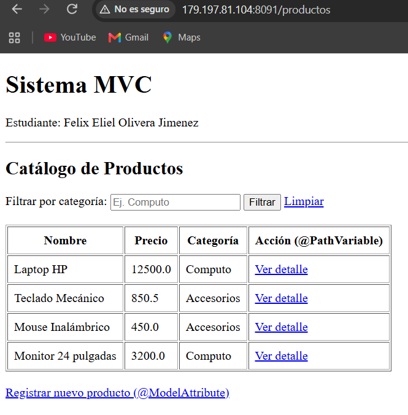
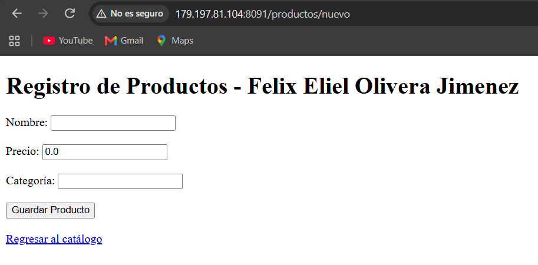
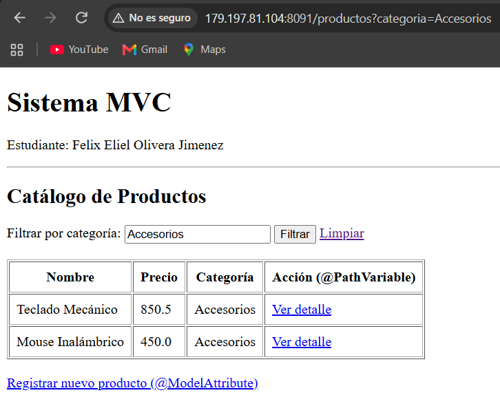
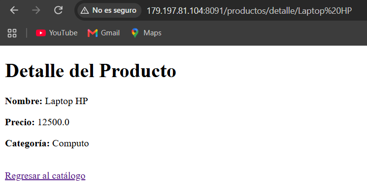
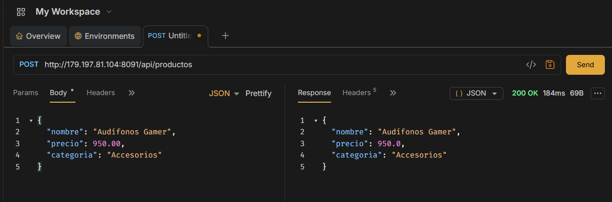

# Actividad 2: Patrón MVC, Thymeleaf y Peticiones en Spring Boot

Proyecto desarrollado para la materia de Ingeniería en Sistemas Computacionales, implementando el patrón Modelo-Vista-Controlador (MVC), renderización del lado del servidor con Thymeleaf, transferencia de datos mediante DTOs, manejo de parámetros y peticiones HTTP.

---

## 🚀 Tecnologías Utilizadas
* Java & Spring Boot
* Thymeleaf (Vistas HTML)
* Maven Wrapper (`mvnw`)
* Git y GitHub
* Bruno (Pruebas de APIs REST)
* Linux VPS (Despliegue en producción)

---

## 📋 Descripción de Endpoints y Vistas

1. **Listado con Model y `th:each`**: `/productos` - Muestra la lista completa de elementos usando el motor de plantillas de Thymeleaf.
2. **Filtrado por Parámetros (`@RequestParam`)**: `/productos?categoria=...` - Permite filtrar los elementos del catálogo por categoría.
3. **Detalle por Identificador (`@PathVariable`)**: `/productos/detalle/{nombre}` - Muestra la información específica de un producto seleccionado.
4. **Formulario y Modelo (`@ModelAttribute`)**: `/productos/nuevo` y `/productos/guardar` - Captura datos mediante formularios web del lado del servidor.
5. **API REST POST (`@RequestBody`)**: `/api/productos` - Recibe un objeto en formato JSON mapeado a un DTO.

---

## 📸 Evidencias y Capturas de Pantalla

### 1. Vista con el listado de elementos (`th:each` funcionando)

> 

### 2. Formulario con `@ModelAttribute`

> 

### 3. Resultado del endpoint con `@RequestParam` (Filtrado)

> 

### 4. Resultado del endpoint con `@PathVariable` (Detalle)

> 

### 5. Petición POST probada en Bruno (`@RequestBody`)
> 

